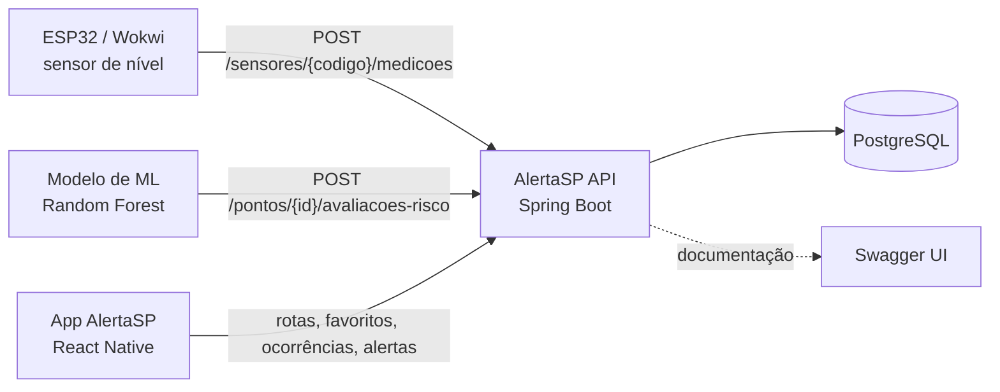
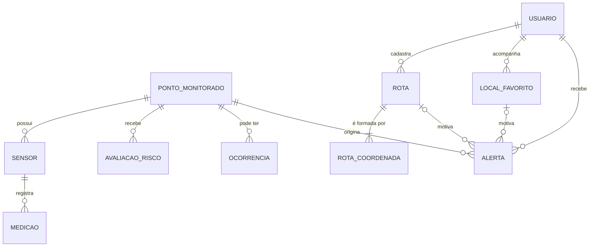
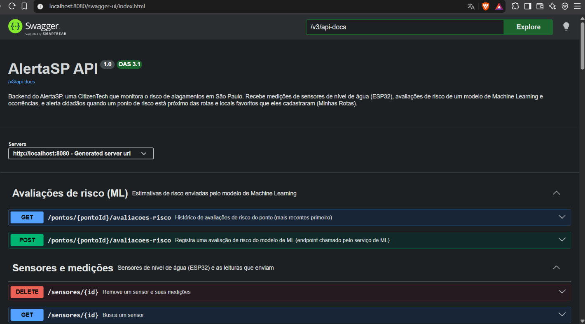
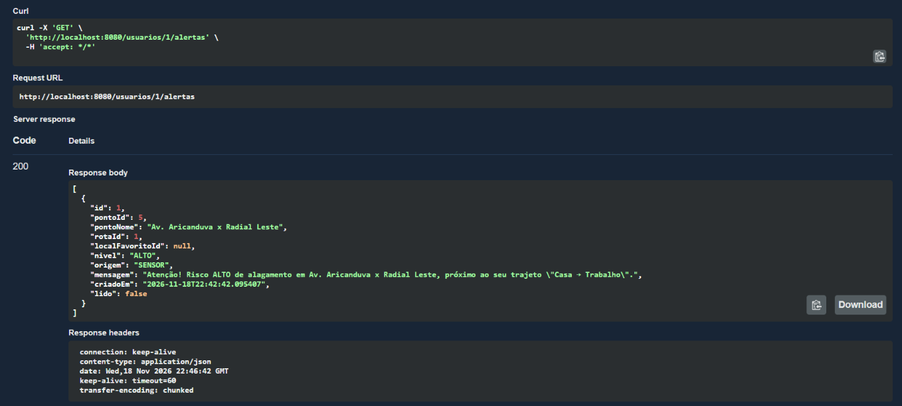

# AlertaSP — Backend (SOA e Web Services)

> **Inteligência que antecipa riscos e protege caminhos.**
> Global Solution FIAP 2026 · CitizenTech · Disciplina: Arquitetura Orientada a Serviços (SOA) e Web Services

## Integrantes

| Nome | RM |
|------|----|
| Bento Rangel | RM559124 |
| Eric Yuji | RM554869 |
| Higor Batista | RM558907 |
| Kaue Pires | RM554403 |
| Ricardo Di Tilia | RM555155 |

## O problema

São Paulo sofre com alagamentos que comprometem deslocamentos, colocam pessoas em risco e dificultam a tomada de
decisão durante chuvas intensas. As informações existem (CGE, INMET, GeoSampa, SP Águas, câmeras da CET), mas estão
espalhadas e não chegam ao cidadão no momento e no lugar em que ele precisa.

## A solução

O **AlertaSP** é uma plataforma que combina três fontes de monitoramento:

- **Sensores de nível de água** (ESP32 + sensor ultrassônico) medem a condição física em pontos críticos;
- **Machine Learning** estima o risco de alagamento a partir de chuva e histórico de ocorrências;
- **Ocorrências** confirmam o que está acontecendo (cidadãos, sensores ou fontes oficiais).

O diferencial é o **Minhas Rotas**: o cidadão cadastra seus trajetos do dia a dia (ex.: *Casa → Trabalho*) e locais
favoritos (casa, escola dos filhos) e recebe alertas **somente** quando um ponto de risco está próximo deles — sem
rastreamento contínuo de GPS.

Este repositório é o **backend** da solução: uma API REST em Spring Boot que recebe os dados do ESP32 e do modelo
de ML, persiste tudo em PostgreSQL e gera os alertas consumidos pelo aplicativo mobile.

**ODS relacionados:** ODS 11 (Cidades e Comunidades Sustentáveis) e ODS 13 (Ação contra a Mudança Global do Clima).

## Arquitetura



O código é organizado **por domínio** (`br.com.fiap.alertasp.<domínio>`), cada um com entidade, repositório, serviço,
controller e DTOs:

| Pacote | Responsabilidade |
|--------|------------------|
| `ponto` | Pontos monitorados (locais com risco de alagamento) |
| `sensor` | Sensores ESP32 e suas medições |
| `risco` | Avaliações do modelo de ML e o `RiscoService`, que aplica o risco e dispara alertas |
| `usuario` | Cidadãos que usam o app |
| `rota` | Minhas Rotas: trajetos guardados como polilinhas |
| `favorito` | Locais favoritos acompanhados pelo cidadão |
| `ocorrencia` | Alagamentos reportados por cidadãos, sensores ou fontes oficiais |
| `alerta` | Geração e consulta de alertas |
| `shared` | Coordenadas, cálculo geográfico, regra de risco, tratamento de erros, configuração do Swagger |

### Modelo de domínio



### Fluxo risco → alerta

1. Um evento define o nível de risco de um ponto:
   - **Medição do sensor:** nível da água = altura de instalação − distância medida. Se atingir o limite do sensor → `ALTO`; se atingir 50% do limite → `MEDIO`; abaixo disso → `BAIXO`.
   - **Avaliação do ML:** usa o nível enviado pelo modelo.
   - **Ocorrência:** fonte `OFICIAL` → `ALTO`; `CIDADAO` ou `SENSOR` → `MEDIO`.
2. O ponto assume o nível do evento mais recente.
3. Se o nível for `ALTO` ou `CRITICO`, o sistema procura as **rotas** que passam dentro do raio de alerta do ponto (distância do ponto até cada trecho do trajeto) e os **locais favoritos** dentro do raio, e cria um alerta para cada usuário afetado.
4. Para não repetir avisos, um usuário não recebe novo alerta do mesmo ponto enquanto houver um alerta não lido criado nas últimas 2 horas.

## Tecnologias

Java 21 · Spring Boot 3.5 (Web, Data JPA, Validation) · PostgreSQL 16 · Flyway · springdoc-openapi (Swagger) ·
JUnit 5 + MockMvc + H2 · Docker Compose

## Como executar

Pré-requisito: **Docker** (com Docker Compose).

```bash
docker compose up --build
```

- API: http://localhost:8080
- Swagger UI: http://localhost:8080/swagger-ui.html
- OpenAPI (JSON): http://localhost:8080/v3/api-docs

O banco é criado e populado automaticamente pelas migrações do Flyway, com dados de demonstração.

Se as portas 8080 ou 5432 já estiverem em uso, troque-as por variáveis de ambiente:

```bash
API_PORT=8081 DB_PORT=5434 docker compose up --build
```

Para parar e apagar os dados: `docker compose down -v`.

### Sem Docker (opcional)

Com Java 21 e um PostgreSQL local (banco, usuário e senha `alertasp`):

```bash
./mvnw spring-boot:run
```

A conexão pode ser alterada com `DB_URL`, `DB_USER` e `DB_PASSWORD`.

## Banco de dados e migrações

O schema é versionado com **Flyway** (`src/main/resources/db/migration`). O Hibernate apenas **valida** o mapeamento
(`ddl-auto: validate`) — nenhuma tabela é criada fora das migrações.

| Versão | Conteúdo |
|--------|----------|
| `V1__pontos_sensores_medicoes.sql` | Pontos monitorados, sensores e medições |
| `V2__usuarios_rotas_favoritos.sql` | Usuários, rotas (com coordenadas ordenadas) e locais favoritos |
| `V3__avaliacoes_ocorrencias_alertas.sql` | Avaliações de risco do ML, ocorrências e alertas |
| `V4__dados_demonstracao.sql` | Dados de demonstração (5 pontos, 5 sensores, usuária com rota e favorito) |

## Testes automatizados

```bash
docker compose run --rm test
```

Os testes rodam em um container Maven, sobre um banco H2 em modo PostgreSQL que executa **as mesmas migrações do
Flyway**. Cobrem:

- cálculo de distância geográfica e regra de risco (testes unitários);
- CRUDs, validações (400), recursos inexistentes (404) e duplicidades (409);
- o fluxo completo: medição → risco do ponto → alerta para a rota próxima (e nenhum alerta para rotas distantes);
- deduplicação de alertas, alertas por avaliação do ML e por locais favoritos;
- leituras sem transação aberta, como em produção.

## Endpoints

A documentação completa, com exemplos, está no Swagger UI.

| Método | Endpoint | Descrição |
|--------|----------|-----------|
| POST / GET | `/pontos` | Cadastra / lista pontos monitorados (`?nivelMinimo=ALTO`) |
| GET / PUT / DELETE | `/pontos/{id}` | Consulta, atualiza ou remove um ponto |
| POST / GET | `/pontos/{id}/avaliacoes-risco` | Registra (ML) / lista avaliações de risco |
| POST / GET | `/sensores` | Cadastra / lista sensores |
| GET / PUT / DELETE | `/sensores/{id}` | Consulta, atualiza ou remove um sensor |
| POST | `/sensores/{codigo}/medicoes` | Registra uma medição (chamado pelo ESP32) |
| GET | `/sensores/{id}/medicoes` | Histórico de medições |
| POST / GET | `/usuarios` | Cadastra / lista usuários |
| GET / PUT / DELETE | `/usuarios/{id}` | Consulta, atualiza ou remove um usuário |
| POST / GET | `/usuarios/{id}/rotas` | Cadastra / lista as rotas do usuário |
| GET / PUT / DELETE | `/usuarios/{id}/rotas/{rotaId}` | Consulta, atualiza ou remove uma rota |
| POST / GET | `/usuarios/{id}/favoritos` | Cadastra / lista locais favoritos |
| GET / PUT / DELETE | `/usuarios/{id}/favoritos/{favoritoId}` | Consulta, atualiza ou remove um favorito |
| GET | `/usuarios/{id}/alertas` | Alertas do usuário (`?lido=false`) |
| PATCH | `/alertas/{id}/lido` | Marca um alerta como lido |
| POST / GET | `/ocorrencias` | Registra / lista ocorrências (`?status=ABERTA`) |
| GET | `/ocorrencias/{id}` | Consulta uma ocorrência |
| PATCH | `/ocorrencias/{id}/status` | Altera o status (ex.: `ENCERRADA`) |

Erros seguem o padrão `ProblemDetail` (RFC 9457): `400` dados inválidos (com o campo `campos`), `404` recurso
inexistente, `409` conflito (e-mail ou código de sensor duplicado, ponto ainda com sensores).

## Roteiro de demonstração

Com a aplicação rodando (dados de demonstração carregados):

```bash
# 1. A usuária demo tem a rota "Casa → Trabalho" (Tatuapé → Av. Paulista)
curl http://localhost:8080/usuarios/1/rotas

# 2. O sensor ESP32-005 (Av. Aricanduva x Radial Leste) envia uma leitura: água a 50 cm (limite 30 cm)
curl -X POST http://localhost:8080/sensores/ESP32-005/medicoes \
     -H "Content-Type: application/json" -d '{"distanciaCm":150}'

# 3. O ponto passa a risco ALTO
curl http://localhost:8080/pontos/5

# 4. A usuária recebe um alerta, porque o ponto fica a menos de 300 m da rota dela
curl http://localhost:8080/usuarios/1/alertas

# 5. O modelo de ML envia uma avaliação para outro ponto
curl -X POST http://localhost:8080/pontos/1/avaliacoes-risco \
     -H "Content-Type: application/json" -d '{"nivel":"ALTO","probabilidade":0.87,"modelo":"random-forest-v1"}'
```

Os mesmos exemplos estão em [`docs/requests.http`](docs/requests.http) (executáveis no IntelliJ ou na extensão
REST Client do VS Code).

## Evidências

Capturas de tela da aplicação em funcionamento estão em [`docs/evidencias/`](docs/evidencias/).

<!-- TODO: adicionar as imagens, por exemplo:


-->

## Próximos passos

- Notificações push no app (hoje o app consulta `/usuarios/{id}/alertas`);
- Autenticação dos usuários e dos dispositivos ESP32;
- Consultas espaciais com PostGIS para grandes volumes de rotas;
- Integração com dados oficiais (CGE, INMET) e visão computacional sobre imagens autorizadas.
